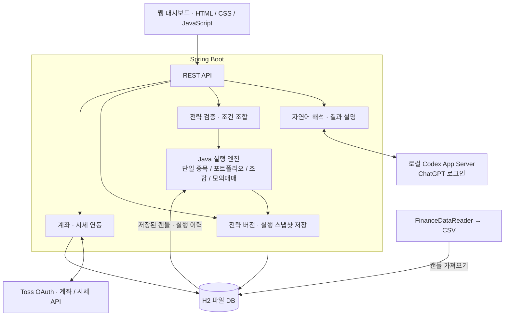

<div align="center">

# Toss Invest

### 자연어로 만든 투자 전략을 검증하고, 실행 결과를 기록하는 국내 주식 분석 프로젝트

전략 입력부터 조건 검증, 백테스트, 결과 비교, 모의매매까지 하나의 흐름으로 연결합니다.


[주요 기능](#features) · [아키텍처](#architecture) · [설계 포인트](#design) · [실행 방법](#getting-started) · [검증](#verification) · [상세 문서](#documents)

</div>

> 문서 기준: **2026-10-20 / `85f2bb7`**<br/>
> 애플리케이션 버전: **`0.0.1-SNAPSHOT`** — README 개편과 애플리케이션 릴리스 버전은 별도로 관리합니다.

<a id="overview"></a>
## 프로젝트 소개

투자 아이디어를 자연어로 입력하면 구조화된 전략으로 변환하고, 사용자가 확인한 조건으로 백테스트를 실행합니다. 결과를 다시 확인할 때도 당시의 전략 버전과 데이터를 기준으로 분석할 수 있도록 실행 이력을 보존합니다.

AI는 자연어 해석과 결과 설명에 사용합니다. **전략 검증, 매매 조건 평가, 체결 계산, 결과 저장은 Java 코드가 수행**합니다. 사용자 전략의 백테스트와 전략별 모의매매는 가상 체결을 사용합니다.

```text
자연어 입력 → 조건 확인·보완 → 전략 저장 → 백테스트 → 결과 분석·비교
                                  └→ 전략별 모의매매 (단일 종목 전략)
```

<a id="features"></a>
## 주요 기능

| 기능 | 구현 내용 |
| --- | --- |
| 자연어 전략 작성 | 로컬 Codex App Server로 전략 JSON 생성, 누락 조건 확인, 저장 전 검증 |
| 전략 버전 관리 | 원문·조건을 버전별로 보존하고, 특정 버전으로 실행 |
| 단일 종목 백테스트 | 이동평균, 돌파, 추세, 가격 범위, 손절·익절·트레일링 조건 평가 |
| 여러 전략 입력·조합 | 최대 10개 전략 초안 생성, 조건을 AND/OR로 조합하고 괄호 구조 유지 |
| 포트폴리오 백테스트 | 상대강도 순위, SMA 필터, 주간 리밸런싱, 동일 비중 배분 |
| 결과 분석·비교 | 가격·거래 표시, 수익률·낙폭, 월별·청산 사유별 집계, 같은 유형의 전략 2~6개 비교 |
| AI 결과 설명 | 저장된 실행 결과를 설명하고, 인용한 사실·수치·거래 ID를 서버에서 검증 |
| 전략별 모의매매 | 저장한 전략 버전으로 가상 계좌를 생성하고 거래·자산·진행 상태 기록 |
| 계좌·시세 대시보드 | Toss OAuth 연결, 계좌·시세 조회, 기존 점수 기반 페이퍼와 1분봉 스캘핑 시뮬레이션 |

### 전략 유형별 지원 범위

| 유형 | 스키마 | 핵심 기능 | 전략별 모의매매 |
| --- | --- | --- | --- |
| 단일 종목 | `1`, `2` | 개별 종목의 진입·청산 조건과 일봉 백테스트 | 지원 |
| 포트폴리오 | `3` | 시장 내 종목 선정, 비중 배분, 리밸런싱 | 미지원 |
| 조합 전략 | `4` | 여러 초안의 조건을 AND/OR로 결합한 백테스트 | 미지원 |

사용자 전략 백테스트는 일봉을 기준으로 합니다. 1분봉 스캘핑은 별도의 고정 규칙 시뮬레이션입니다.

### 최신 반영: 이동평균 추세와 52주 가격 조건

- **`MA_TREND`**: 현재 SMA와 한 달 전 SMA를 비교합니다. 예를 들어 “SMA200이 한 달 전보다 상승”은 현재 가격과 SMA200의 비교가 아닙니다.
- **`RANGE_RATIO`**: 현재 종가가 52주 최고가의 75% 이상인지, 52주 최저가의 130% 이상인지 등을 평가합니다.
- **`CALENDAR_WEEKS`**: 52주 범위는 달력상 주 단위로 계산합니다. 252거래일로 대체하지 않습니다.
- **AND 조건**: 정배열·추세·가격 범위를 함께 지정하면 모든 조건이 충족되어야 진입합니다.

구체적인 조건과 검증 사례는 [전략 확장 명세](.docs/strategy-expansion.md), [전략 예제 JSON](src/test/resources/demo/strategy-trend-template.json), [경계 조건 테스트](src/test/java/com/tossinvest/tossinvestbackend/strategy/TrendTemplateTests.java)에서 확인할 수 있습니다.

<a id="architecture"></a>
## 아키텍처



### 기술 스택

| 구분 | 기술 | 용도 |
| --- | --- | --- |
| 언어·빌드 | Java 17, Gradle Wrapper 8.14.5 | 서버 개발·빌드·테스트 |
| 서버 | Spring Boot 3.5.15, Spring MVC | REST API와 정적 웹 화면 제공 |
| 데이터 접근 | Spring Data JPA, H2 | 캔들·전략·실행 결과·모의매매 상태 저장 |
| 외부 연동 | Spring WebFlux / WebClient | 계좌·시세 API 통신 |
| 웹 화면 | HTML, CSS, Vanilla JavaScript | 전략 작성·분석·비교·모의매매 UI |
| 자연어 처리 | Codex App Server | ChatGPT 로그인 기반 전략 해석·결과 설명 |
| 데이터 수집 | Python, FinanceDataReader | 국내 주식 일봉 CSV 수집 |
| 검증 | JUnit, Spring Boot Test, Node.js, Playwright / Edge | 엔진·API·브라우저 검증 |

<a id="design"></a>
## 주요 설계 포인트

### 1. 자연어 해석과 전략 실행의 책임 분리

자연어를 바로 실행하지 않고 `StrategyDefinition`으로 변환한 뒤 검증합니다. 조건이 부족하면 사용자에게 보완을 요청하고, 확인한 전략만 저장·실행합니다.

- AI 호출: 자연어 해석, 여러 전략 초안 생성, 실행 결과 설명 생성
- Java 처리: 조건 검증·조합, 저장·삭제, 지표 계산, 백테스트, 모의매매, 이력 조회
- Codex 연결: 로컬 `codex app-server`와 ChatGPT 로그인 사용. **API 키 방식으로 자동 전환하지 않습니다.** 계정의 Codex 사용 한도는 적용됩니다.

### 2. 변경된 전략과 과거 실행 결과 분리

전략을 수정해도 기존 버전과 실행 이력을 덮어쓰지 않습니다. 각 실행에는 해당 유형에 맞는 전략·캔들·체결 방식·비용 적용 상태·거래 근거를 스냅샷으로 저장합니다.

차트와 결과 설명은 **저장된 실행 당시의 사실**을 사용합니다. 이후 전략이나 시세 데이터가 바뀌더라도 과거 결과의 해석 기준을 유지합니다.

### 3. 조건의 의미와 데이터 부족을 명시

- 달력 한 달 전 SMA와 현재 SMA를 비교하는 추세 조건을 별도로 모델링합니다.
- 조합 전략은 AND/OR와 괄호 구조를 유지하며, 선택한 초안의 출처와 제외 사유를 보존합니다.
- 요청 기간과 실제 평가 기간, 지표 준비에 필요한 과거 데이터 부족을 구분해 표시합니다.
- OR 조건으로 진입이 가능했더라도 다른 조건의 데이터 부족은 별도로 남깁니다.
- 다음 날 시가 체결에 필요한 다음 봉이 없으면 체결을 임의로 만들어내지 않습니다.

### 4. 지표의 계산 기준을 구분

| 실행 유형 | 결과를 읽는 기준 |
| --- | --- |
| 단일 종목 | 청산 거래 수익률의 단순 합계. 자본금·거래 비용을 적용한 계좌 수익률이 아닙니다. 낙폭은 이 합계의 하락 폭(%p), Sharpe는 비연율화 지표입니다. |
| 포트폴리오·조합 | 초기 자본, 비용, 현금과 보유 포지션을 반영한 계좌 기준 결과를 사용합니다. |

비교 실행은 **같은 유형의 전략 2~6개**에 동일한 데이터와 실행 설정을 적용합니다. 유형이 다른 결과를 같은 수익률 척도로 직접 비교하지 않습니다.

### 5. 결과 설명을 저장된 사실로 검증

AI 설명에서 참조한 사실 ID, 수치, 거래 ID를 서버가 검증하고 검증된 설명을 저장합니다. 설명 조회는 AI를 다시 호출하지 않으며, 설명 생성이 실패해도 차트와 거래 내역을 조회할 수 있습니다.

<a id="getting-started"></a>
## 로컬 실행

### 준비 사항

- **필수**: JDK 17, 저장소에 포함된 Gradle Wrapper
- **계좌·실시간 시세 연동**: Toss OAuth 클라이언트 정보
- **자연어 해석·AI 설명**: `codex` 실행 파일과 ChatGPT 로그인
- **CSV 수집**: Python과 `finance-datareader`
- **전체 자동 검증**: Node.js, Playwright 모듈, Microsoft Edge

현재 공통 보안 설정은 개발용으로 API 접근을 허용합니다. 아래 명령처럼 **`127.0.0.1`에 바인딩해 로컬에서 실행**합니다. 자연어 지원 API에는 루프백·동일 출처 검사도 적용됩니다.

### 1. 저장소 내려받기

```powershell
git clone https://github.com/dkffprtm0404-rgb/toss-invest.git
cd toss-invest
java -version
```

### 2. 계좌·시세 연결 설정

Git에서 제외된 `src/main/resources/application-local.yaml`을 준비합니다.

```yaml
toss:
  oauth:
    client-id: ${TOSS_OAUTH_CLIENT_ID}
    client-secret: ${TOSS_OAUTH_CLIENT_SECRET}
```

PowerShell 세션에 본인의 연결 정보를 설정합니다.

```powershell
$env:TOSS_OAUTH_CLIENT_ID = "발급받은-client-id"
$env:TOSS_OAUTH_CLIENT_SECRET = "발급받은-client-secret"
```

토스 연결 정보가 없는 경우 아래 [자동 통합 검증](#verification)으로 고정 데이터 기반 흐름을 확인할 수 있습니다.

### 3. Codex 로그인 — AI 기능 사용 시

```powershell
codex login
codex login status
```

코드의 기본 모델 설정은 `gpt-5.6-terra`입니다. 필요하면 `STRATEGY_CODEX_MODEL`로 변경합니다. 실행 파일을 자동으로 찾지 못하면 `STRATEGY_CODEX_EXECUTABLE`을 설정합니다. 연결 상태와 자세한 설정은 [Codex 웹 연동 안내](.docs/codex-strategy-web.md)를 참고하세요.

### 4. 서버 시작

```powershell
.\gradlew.bat bootRun --args='--server.address=127.0.0.1'
```

macOS / Linux:

```bash
./gradlew bootRun --args='--server.address=127.0.0.1'
```

브라우저에서 [http://localhost:8090](http://localhost:8090)에 접속합니다. H2는 `./data/tossinvest` 파일 DB를 사용하며, 같은 작업 디렉터리와 DB 경로로 재시작하면 저장된 데이터가 유지됩니다.

### 5. 캔들 데이터 준비 — CSV 수집 사용 시

저장소 루트에서 실행합니다. 수집에는 외부 네트워크가 필요합니다.

```powershell
python -m pip install finance-datareader
python scripts/fetch_candles.py
Invoke-RestMethod -Method Post -Uri "http://localhost:8090/api/backtest/import-csv"
```

수집 스크립트는 실행 시점의 KOSPI·KOSDAQ 시가총액 상위 종목을 대상으로 `scripts/candles.csv`를 생성합니다. 가져오기 API의 기본 경로도 이 파일입니다.

**현재 상장 종목 목록을 과거 시점의 시장 구성으로 간주하지 않습니다.** 포트폴리오 백테스트에는 시점별 구성 종목과 거래일 정보가 별도로 필요합니다. 현재 스크립트가 시장 전체의 과거 구성 정보를 자동 구축하는 것은 아닙니다.

### 첫 전략 예시

> 5일 이동평균선이 20일 이동평균선을 상향 돌파하면 매수하고, 매수가 대비 5% 하락하면 손절해. 다른 진입 필터나 청산 조건은 없어.

화면에서 해석된 조건을 확인하고 전략을 저장한 다음 종목·기간·체결 방식을 선택합니다. 필요한 캔들이 없다면 데이터를 준비한 뒤 다시 실행합니다.

단일 종목 저장 전략(형식 1·2)의 백테스트에는 [실행 전 데이터 준비 사전 점검](.docs/data-readiness.md)을 추가합니다. 요청 기간·저장 범위·봉 수와 진입 판단 준비 여부를 구분하며, 점검 조회는 데이터를 수집하거나 실행 이력을 저장하지 않습니다.

<a id="verification"></a>
## 검증

### 자동 통합 검증

저장소 루트에서 Java 17, Node.js, Playwright 모듈과 Edge를 준비한 뒤 실행합니다.

```powershell
.\scripts\verify-stage9.ps1
```

Java나 Node 모듈 위치를 직접 지정해야 하는 경우:

```powershell
.\scripts\verify-stage9.ps1 `
  -JavaHome "C:\Program Files\Java\jdk-17" `
  -NodeModules "C:\your-node-project\node_modules"
```

의존성이 이미 캐시되어 있다면 `-Offline`을 추가할 수 있습니다. Gradle 캐시 경로는 `-GradleUserHome`으로 지정합니다.

| 검증 대상 | 내용 |
| --- | --- |
| Java | 전략·체결·저장·API 테스트와 `bootJar` 빌드 |
| Node.js / 브라우저 | 화면 로직 및 Edge 기반 UI 테스트. 테스트 동시 실행 수는 1로 제한 |
| 전략 흐름 | 자연어 초안 → 검증 → 저장 → 실행 → 이력·분석 조회 |
| 실행 격리 | `stage9-test` 프로필, 테스트용 DB, 외부 서비스 고정 응답 사용 |

결과는 `build/stage9-verification.json`, 실행 로그, `build/reports/tests/test/index.html`과 브라우저 캡처에서 확인합니다. 자세한 준비·판정 기준은 [통합 검증 실행 안내](.docs/integration-demo.md)를 참고하세요.

이 검증은 실제 토스 인증 정보나 Codex 로그인 없이 수행하도록 구성되어 있습니다. **실제 외부 API 연결, 실모델 응답, 장기간 운영까지 통과했다는 의미는 아닙니다.** 테스트 수와 성공 여부는 각 실행의 결과 파일로 확인합니다.

<a id="api"></a>
## 주요 API

| 영역 | 대표 API | 용도 |
| --- | --- | --- |
| 자연어 전략 | `POST /api/strategy-assistant/interpret` | 단일 전략 해석 |
| 일괄 입력·조합 | `POST /api/strategy-assistant/interpret-batch`, `POST /api/strategy-assistant/compose` | 여러 초안 생성·조건 조합 |
| 전략 관리 | `POST /api/strategies`, `GET /api/strategies/{id}/versions` | 전략 저장·버전 조회 |
| 단일 종목 | `POST /api/strategies/{id}/backtests` | 저장한 버전으로 백테스트 |
| 포트폴리오 | `POST /api/strategies/{id}/portfolio-backtests` | 포트폴리오 실행 |
| 조합 전략 | `POST /api/strategies/{id}/composite-backtests` | 조합 전략 실행 |
| 분석·설명 | `GET /api/backtest/runs/{id}/analysis`, `POST /api/backtest/runs/{id}/explanation` | 저장된 단일 종목 결과 분석·AI 설명 생성 |
| 비교 | `POST /api/comparisons` | 같은 유형의 전략 비교 |
| 전략별 모의매매 | `POST /api/strategy-paper/runs`, `POST /api/strategy-paper/runs/{id}/refresh` | 가상 계좌 생성·갱신 |
| 캔들 | `POST /api/backtest/import-csv`, `GET /api/backtest/candle-status` | CSV 가져오기·저장 현황 |
| 실행 전 데이터 준비 | `GET /api/strategies/{id}/data-readiness` | 저장 버전과 요청 기간의 진입 판단 준비 여부 조회 |

자연어 지원 API의 변경 요청에는 로컬·동일 출처 검사와 `X-Strategy-Local: 1` 헤더가 적용됩니다. 요청 본문과 오류 응답은 아래 기능별 명세를 참고하세요.

<a id="paper-trading"></a>
## 모의매매와 운영 동작

### 저장한 전략으로 모의매매

저장한 단일 종목 전략(`schemaVersion` 1·2)에 종목, 체결 방식, 초기 자본, 배분과 비용을 지정하면 독립된 가상 계좌가 생성됩니다.

- 시작 당시 전략 버전을 고정하고 거래·자산·대기 주문·로그를 저장합니다.
- 시작 다음 한국 날짜부터의 신호를 대상으로, 오늘 이전에 확정된 일봉을 처리합니다.
- 신규 진입 중단 시 대기 매수는 취소하지만 보유분은 기존 청산 조건으로 관리합니다.
- 일정 실행은 시작 후 60초 지연, 이후 작업 종료 기준 30분 간격입니다.
- 조회 API는 저장 상태를 읽습니다. 수동 `refresh`는 시세 제공자를 호출합니다.
- 확정봉을 기다리는 `WAITING_DATA`와 호출 제한 `MARKET_RATE_LIMITED`를 구분합니다.

설정과 상태 전이는 [전략별 모의매매 명세](.docs/strategy-paper-trading.md)에 정리되어 있습니다.

<details>
<summary><strong>기존 점수 기반 페이퍼와 1분봉 스캘핑 규칙</strong></summary>

#### 기존 페이퍼

- 평일 15:40 KST 신규 매수 평가, 정규장 5분·NXT장 10분 간격 보유분 감시
- 승률로 신규 매수를 차단하지 않음. 최근 달력 10일의 청산 수익률 합계가 -7% 이하이면 신규 매수 중단
- 수익률·최고 수익률 소수 6자리 저장, 최근 거래 매수가 표시, 요약 1분 갱신
- HTTP 오류는 실패로 표시하고, 실행·스캔 요청 중 중복 클릭 방지

#### 1분봉 스캘핑 시뮬레이션

- `ScalpingUniverse`의 고정 10종목을 평일 매분 평가
- 09:01~15:20 이전 신규 진입, 15:20~15:35 보유분 청산 시도
- 캔들 시간순 정렬, 진행 중 분봉 제외, 최신 확정봉이 2분보다 오래되면 거래하지 않음
- 거래량 1.2배 이상 **AND** 다음 중 하나: EMA 추세 / RSI 30~65 반등 / 직전 3봉 종가 저점 대비 0.5% 반등
- 익절 +2%, 손절 -0.6%, 최고 수익 +1% 도달 후 본전 청산
- 대상 목록에서 제외된 보유 종목도 감시하며, 청산에 지표 준비용 22봉을 요구하지 않음
- 시세 장애로 청산하지 못하면 포지션을 유지하고 로그 기록

대상·통계는 `/api/scalping/universe`, `/api/scalping/stats`로 조회합니다. `/api/scalping/debug/005930`은 시세 API를 호출합니다. `/api/scalping/tick` 수동 스캔에도 자동 실행과 동일한 조건을 적용합니다.

기존 H2 컬럼은 `ddl-auto: update`로 정밀도를 변경하지만, 이미 반올림해 저장한 과거 값은 복원하지 않습니다.

</details>

<a id="structure"></a>
## 프로젝트 구조

```text
src/main/java/com/tossinvest/tossinvestbackend/
├── strategy/          # 전략 모델·검증·조건 평가·버전 저장
│   └── assistant/     # Codex 연동·일괄 입력·조건 조합
├── backtest/          # 단일 종목 백테스트·결과 분석·설명
├── portfolio/         # 포트폴리오 백테스트
├── composite/         # 조합 전략 백테스트
├── comparison/        # 전략 비교·비교 이력
├── strategypaper/     # 저장 전략 기반 모의매매
├── paper/             # 기존 점수 기반 페이퍼
├── scalping/          # 1분봉 스캘핑 시뮬레이션
├── account/           # 계좌 조회
├── client/            # 외부 API 클라이언트
├── oauth/             # Toss 인증 연동
└── config/            # 서버·보안 설정

src/main/resources/
├── static/            # 대시보드 HTML·CSS·JavaScript
└── codex/             # 전략 출력 JSON 스키마

src/test/              # 엔진·API·통합 테스트·데모 데이터
scripts/               # 캔들 수집·자동 검증·브라우저 테스트
.docs/                 # 기능 명세·API·설계·실행 안내
```

<a id="documents"></a>
## 상세 문서

| 주제 | 문서 |
| --- | --- |
| 전략 모델·기본 실행 | [전략 명세](.docs/strategy-spec.md) · [사용자 전략 백테스트](.docs/user-strategy-backtest.md) |
| 버전·실행 이력 | [전략·실행 결과 저장](.docs/strategy-persistence.md) |
| 자연어 작성 | [Codex 웹 연동](.docs/codex-strategy-web.md) · [여러 전략 입력](.docs/strategy-batch-input.md) |
| 조건 확장 | [이동평균·돌파·52주 가격 조건](.docs/strategy-expansion.md) |
| 포트폴리오·조합 | [포트폴리오](.docs/strategy-portfolio.md) · [조합 전략](.docs/strategy-composition.md) |
| 결과·비교 | [분석·AI 설명](.docs/backtest-results-explanation.md) · [전략 비교](.docs/strategy-comparison.md) |
| 모의매매 | [전략별 모의매매](.docs/strategy-paper-trading.md) · [기존 매매 규칙](.docs/trading-rules.md) |
| 자동 검증 | [통합 검증 실행 안내](.docs/integration-demo.md) |
